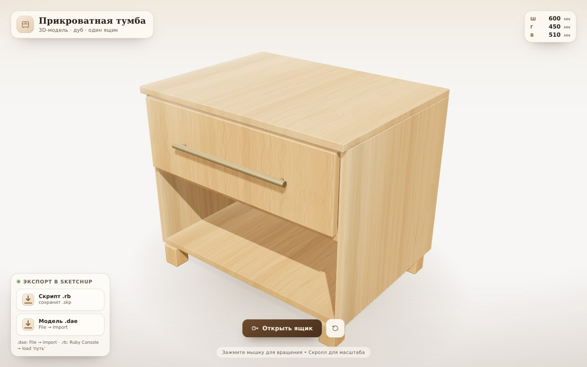
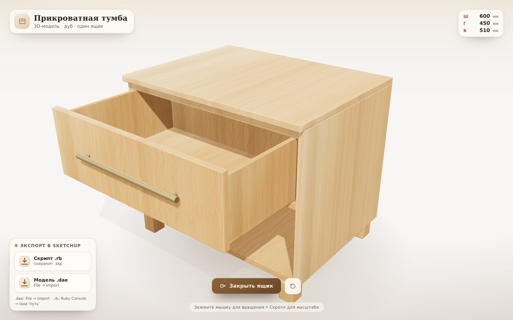

# 🪵 Прикроватная тумба — 3D-модель

Интерактивная 3D-модель прикроватной тумбы с выдвижным ящиком: вращение мышью,
зум, анимация ящика и экспорт модели в SketchUp.

**Габариты:** 600 × 450 × 510 мм (Ш × Г × В), дуб, один ящик, латунная ручка-скоба.



<details>
<summary>Ящик открыт</summary>



</details>

## Возможности

- **3D-просмотрщик** на Three.js: реалистичные материалы, мягкие тени, окружение.
- **Выдвижной ящик** — кнопка «Открыть ящик», клик по модели или `Space`.
- **Орбитальная камера** — вращение, зум, сброс ракурса кнопкой или клавишей `R`.
- **Экспорт в SketchUp**:
  - `tumba-600x450x510.rb` — Ruby-скрипт, строит модель в SketchUp
    (группы «Корпус», «Ящик», «Ручка», материалы, тег «Тумба»);
  - `tumba-600x450x510.dae` — COLLADA-модель в миллиметрах для `File → Import`.
- **Адаптивная вёрстка** — работает на телефоне и на десктопе.
- **Без сборки и внешних CDN**: Three.js лежит в `vendor/`, текстуры генерируются в браузере.

## Запуск локально

Достаточно любого статического сервера из корня проекта:

```bash
python3 -m http.server 8080
# или
npx serve .
```

Откройте <http://localhost:8080>.

## Как импортировать в SketchUp

**Вариант 1 — Ruby-скрипт (даёт редактируемую геометрию):**

1. Скачайте `tumba-600x450x510.rb` кнопкой «⬇ Скрипт .rb».
2. SketchUp → `Window → Ruby Console`.
3. Выполните:
   ```ruby
   load 'C:/путь/к/tumba-600x450x510.rb'
   ```
4. `File → Save As…` → `*.skp`.

**Вариант 2 — COLLADA:**

1. Скачайте `tumba-600x450x510.dae`.
2. SketchUp → `File → Import…` → выберите файл, единицы — миллиметры.

## Структура проекта

```
index.html            разметка и UI
assets/styles.css     оформление, адаптив
src/main.js           сцена, свет, камера, анимация ящика, обработчики
src/nightstand.js     габариты и детали модели (единый источник размеров)
src/textures.js       процедурная текстура дуба на canvas
src/sketchup.js       генератор Ruby-скрипта для SketchUp
src/exporters.js      экспорт в COLLADA (.dae) и скачивание файлов
vendor/               Three.js r150 + OrbitControls, ColladaExporter, RoomEnvironment
```

Все размеры заданы в миллиметрах в `src/nightstand.js` — из этого же списка
деталей собираются и 3D-сцена, и Ruby-скрипт для SketchUp, поэтому они всегда совпадают.

## Публикация (GitHub Pages)

Сайт — статический, поэтому публикуется напрямую из ветки:
`Settings → Pages → Source: Deploy from a branch → Branch: <ветка>, / (root)`.

Адрес: <https://user5067136.github.io/3d-tumba/>.

## Клавиши

| Клавиша | Действие |
| --- | --- |
| `Space` | открыть / закрыть ящик |
| `R` | сбросить ракурс камеры |
| мышь / тач | вращение, зум |

## Лицензия

Код проекта — MIT. Three.js распространяется по лицензии MIT
(см. `vendor/three-LICENSE.txt`).
